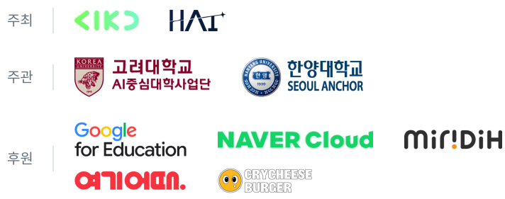

# 2026 Haikuthon Dataset Generation

<p align="center">
  <a href="https://huggingface.co/datasets/KimWooJin/26-haikuthon-train"></a>
  <a href="https://huggingface.co/datasets/KimWooJin/26-haikuthon-test"></a>
  <a href="https://www.kaggle.com/competitions/2026-haikuthon/overview"></a>
</p>

- 주제: Multimodal RAG
- 일시: 2026년 11월 21일 ~ 2026년 11월 22일 (무박 2일)
- 장소: 고려대학교 애기능생활관

2026 Haikuthon에서 사용된 데이터셋을 재현하기 위한 레포지토리입니다.
데이터셋 생성 파이플라인은 크게 1. 장면 구성 요소 정의 2. 프롬프트 생성 3. 이미지 생성의 3단계로 구성되어있습니다.
아래 파이프라인을 이용해 대회에서 사용된 데이터셋을 재현하거나 새로운 데이터셋을 생성할 수 있습니다.
실제 대회에서 사용된 데이터셋은 HuggingFace에서 확인하실 수 있습니다.

## Reproduce

아래의 세 단계를 통해 데이터셋을 생성할 수 있습니다.
Stage 2와 Stage 3-1에는 OpenAI API 키(OPENAI_API_KEY)가 필요합니다. Stage 3-2는 BF16을 지원하는 NVIDIA CUDA GPU에서 실행합니다. 
대회용 테스트 이미지는 NVIDIA RTX PRO 6000 Blackwell(96 GB VRAM)에서 생성했습니다.

Stage 1, Stage 2, Stage 3-1을 실행하기 위한 의존성은 `requirements.txt`를 통해 설치할 수 있습니다.
Stage 3-2의 의존성은 별도의 Python 환경에서 `requirements-stage3-qwen.txt`를 통해 설치할 수 있습니다.


### Stage 1. Generate scene components

Stage 1에서는 객체의 종류·수량·속성, 객체 간 관계, 배경과 조명을 조합해 각 장면에 들어갈 구성 요소들을 정의합니다.
프롬프트에 사용되는 구성 요소와 조합 규칙은 [components.yaml](stage1_components/components.yaml)에 정의되어 있습니다.

아래 실행 명령어를 통해 train 4,000개, test 16,000개에 대해 장면 구성 요소를 정의합니다.
결과물은 outputs_stage1에 저장됩니다.

```bash
python -m stage1_components generate
```


### Stage 2. Generate image prompts

Stage 2에서는 LLM을 사용해 Stage 1에서 정의한 장면 구성 요소를 자연어 프롬프트로 변환합니다.
장면마다 프롬프트를 하나씩 생성하며, 미리 정의한 문체 조건을 적용해 표현을 다양화합니다.
대회에 사용된 프롬프트는 GPT 6.1 Terra를 이용해 생성하였습니다.

```bash
python -m stage2_prompt_generation --split train --wait
python -m stage2_prompt_generation --wait
```


### Stage 3. Render dataset images

Stage 3에서는 Stage 2의 프롬프트마다 이미지 한 장을 생성합니다.
이미지는 768 × 768 크기의 PNG로 `outputs_stage3`에 저장합니다.

#### Stage 3-1. Train set: OpenAI

학습 세트의 이미지는 OpenAI Batch API로 생성합니다. 
기본 모델은 `gpt-image-2.5-flare`입니다.

```bash
python -m stage3_openai_api submit --split train
```

```bash
python -m stage3_openai_api collect --batch-id batch_... --wait
```

#### Stage 3-2. Test set: Qwen

테스트 세트의 이미지는 8스텝 Lightning LoRA를 적용한 Qwen-Image-2512로 생성합니다.

```bash
python -m stage3_image_generation serve
```

```bash
python -m stage3_image_generation generate --split test
```

## 주최 · 주관 · 후원


