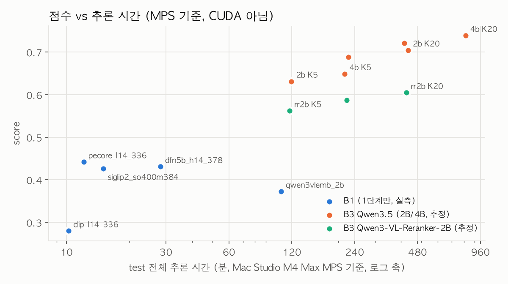
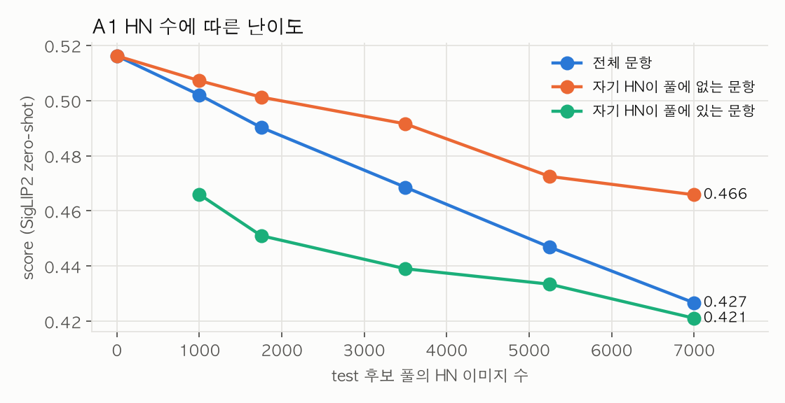

# HAIKUTHON Text→Image Retrieval 베이스라인 실험 보고서

**작성:** 이찬 (운영진) · **작성일:** 2026-11-10 · **대상:** 11/11 운영진 회의

**관련 문서:** 실험 계획 [PLAN.md](PLAN.md) · 결과 스키마 [RESULTS_SCHEMA.md](../RESULTS_SCHEMA.md) · 전체 수치 [results/leaderboard.csv](results/leaderboard.csv)

---

## 요약

본 보고서는 HAIKUTHON 출제 데이터(test 프롬프트 8,000개, 후보 이미지 15,000장)를 참가자 조건에서 직접 풀어 보고, 대회 규정(추론 시간 제한, 모델 크기 제한, train 하드 네거티브 제공 여부, 난이도, 규정 허점)을 결정하기 위한 정량적 근거를 제시한다.

1. **2단계 설계의 효과가 크다.** 1단계 dual encoder 단독 성능은 score 0.43–0.44이다. 4B 규모 VLM으로 1단계 top-20을 재정렬하면 0.739까지 상승한다(+0.29). 1단계 top-20 재현율이 0.98 수준이므로 재정렬의 상한이 충분히 열려 있다.
2. **추론 시간 제한은 2–4B VLM으로 top-5–10을 재정렬할 수 있는 수준이 타당하다.** 단, 본 측정은 MPS(Apple Silicon) 기준이므로, 분 단위 제한값은 대상 CUDA GPU에서 실측해 확정해야 한다(§5.1).
3. **난이도의 주된 원천은 하드 네거티브(HN)가 아니라 stage1의 8문항 유사 묶음 구조이다.** HN 7,000장은 score를 0.09 낮춘다. Public(HN 없음, 0.466)과 Private(0.421)의 차이는 0.045에 그친다.
4. **문항 간 1:1 할당은 +0.08–0.10의 이득을 준다.** 이는 규정상 금지된 방법이며, 프롬프트 텍스트만으로 재현할 수 있다. 따라서 조항만으로는 막기 어렵고 채점 서버 차원의 구조적 차단이 필요하다. 이미지 아티팩트를 이용한 HN 판별은 유효하지 않다(AUC 0.547).
5. **현재 데이터 패키지에는 정답이 누수된다.** 원본 이미지 파일명이 프롬프트 id와 일치하며, HN의 id 범위와 순서가 노출되어 있다. 배포 전 익명화가 필수이다.

---

## 1. 서론

### 1.1 목적

HAIKUTHON 태스크는 텍스트 프롬프트 하나에 대해 후보 이미지 풀 전체를 관련도 순으로 정렬하는 text-to-image retrieval이다. 프롬프트마다 정답 이미지는 정확히 1장이다. 출제 의도는 1단계(빠른 dual encoder)로 후보를 줄이고 2단계(무거운 모델)로 재정렬하는 구조를 참가자가 스스로 설계하게 하는 것이다. 본 실험은 이 의도가 실제 데이터에서 성립하는지 확인하고, 아래 다섯 가지 미결 사항에 대한 근거를 측정하는 것을 목적으로 한다.

| # | 미결 사항 |
|---|---|
| Q1 | 추론 시간 제한값 |
| Q2 | 모델 크기·제출물 용량 제한의 필요성 |
| Q3 | train HN 500장의 제공 여부 |
| Q4 | test HN 수(7,000장)의 적절성 |
| Q5 | 규정 허점의 존재와 그 이득의 크기 |

### 1.2 범위

- 모든 수치는 `results/`의 실측값이다. 측정값을 외삽한 값은 **(추정)**으로 표기한다.
- 측정 장비는 Mac Studio M4 Max(MPS, 통합 메모리 36GB)이다. 따라서 **시간 수치는 CUDA 환경의 규정값으로 바로 쓸 수 없다.**

---

## 2. 실험 설정

### 2.1 데이터와 평가 분할

| 항목 | 내용 |
|---|---|
| 질의 | test 프롬프트 8,000개 (`outputs_stage2/test_prompts_v2.jsonl`) |
| 후보 풀 | 15,000장 = 원본 8,000 + HN 7,000 (`test_v1` 패키지) |
| 구조 | stage1 기준 문항 800개 + 8문항 유사 묶음 900개(7,200문항). 묶음 안의 문항은 배경·화풍·시점·총 객체 수를 공유하고 객체·개수 배분·속성·관계만 다르다. |
| Public / Private | Public = HN이 후보 풀에 없는 1,000문항(test `7000–7999`), Private = 나머지 7,000문항. 패키지에 HN 출처 기록이 없어 파일 순서와 이미지 유사도로 복원하였다(§6). |
| 개발용 val | train 4,000문항에서 묶음 단위로 분리한 500문항(B2 모델 선택, L2 검증에 사용) |

### 2.2 평가 지표

문항별 점수는 `score = (Recall@1 + NDCG@5) / 2`이며, 전체 점수는 문항 평균이다. 정답 순위를 r이라 하면 NDCG@5 = 1/log₂(r+1)(r ≤ 5), 그 외에는 0이다.

- 동점은 비관적으로 처리한다. 즉 정답과 점수가 같은 오답은 정답보다 높은 순위로 둔다.
- 95% 신뢰구간은 문항 단위 bootstrap(1,000회)으로 구한다.

### 2.3 실험군

| 코드 | 내용 | 분류 |
|---|---|---|
| B0 | 랜덤 랭킹(지표 검증) | honest |
| B1 | zero-shot dual encoder, 전체 후보 코사인 유사도 정렬 | honest |
| B2 | dual encoder 파인튜닝(in-batch / 묶음 배치 / +train HN) | honest |
| B3 | 2단계 재정렬: 1단계 top-K를 VLM이 문항별로 독립 채점 | honest |
| A1 | 후보 풀 HN 수에 따른 난이도 변화 | 분석 |
| L0 | 데이터 패키지 누수 감사 | loophole |
| L1 | 문항 간 1:1 할당(Hungarian 등) | loophole(규정 위반) |
| L2 | 이미지 단위 HN 판별기를 점수 prior로 사용 | loophole(출제 의도 우회) |

### 2.4 B3 평가 프로토콜

재정렬 비용 때문에 B3는 test에서 층화 추출한 400문항(Private 300 + Public 100, seed 0)에서만 평가하였다. 이 부분집합에서 1단계(SigLIP2) score는 0.447이다(전체 0.427).

재정렬 점수는 쌍마다 독립이다. 따라서 top-20을 한 번 채점해 K ∈ {5, 10, 20}의 결과를 모두 얻었다. full-test 소요 시간은 측정한 쌍당 시간에 8,000 × K를 곱해 외삽하였다(추정).

### 2.5 실행 환경

- PyTorch 2.15, MPS 백엔드, fp16/bf16
- 실험 기간 중 일부 구간에서 동일 머신의 다른 작업과 자원을 공유하였으므로, 시간 측정에는 잡음이 포함될 수 있다.

---

## 3. 결과

### 3.1 B0: 지표 검증

랜덤 랭킹의 평균 정답 순위는 7,429로 기댓값 7,500.5와 일치한다. 순위 분포의 균일성도 기각되지 않았다(KS 검정 p = 0.41). 지표 구현은 정상이다.

### 3.2 B1: zero-shot dual encoder


**표 1.** zero-shot dual encoder 성능 (test 8,000문항, 후보 15,000장)

| 모델 | score [95% CI] | R@1 | Public | Private | 기준 / 묶음 | R@5 / R@10 / R@20 | 시간(MPS) | 피크 메모리 | 파라미터 |
|---|---|---|---|---|---|---|---|---|---|
| PE-Core-L/14@336 | **0.442** [0.434, 0.451] | 0.328 | 0.480 | 0.436 | 0.799 / 0.402 | 0.761 / 0.904 / 0.969 | 12.1분 | 4.1GB | 0.67B |
| DFN5B ViT-H/14@378 | 0.431 [0.422, 0.440] | 0.318 | 0.475 | 0.424 | 0.809 / 0.389 | 0.746 / 0.913 / **0.988** | 28.2분 | 6.0GB | 0.99B |
| SigLIP2 so400m/16@384 | 0.427 [0.418, 0.435] | 0.315 | 0.466 | 0.421 | 0.820 / 0.383 | 0.741 / 0.908 / 0.984 | 15.0분 | 6.2GB | 1.14B |
| Qwen3-VL-Embedding-2B | 0.373 [0.363, 0.381] | 0.272 | 0.421 | 0.366 | 0.762 / 0.329 | 0.658 / 0.843 / 0.945 | 106.8분 | 8.3GB | 2.13B |
| OpenAI CLIP-L/14@336 | 0.280 [0.272, 0.288] | 0.193 | 0.311 | 0.276 | 0.634 / 0.241 | 0.533 / 0.729 / 0.868 | 10.3분 | 3.0GB | 0.43B |

- 최신 dual encoder 3종(PE-Core, DFN5B, SigLIP2)은 0.43–0.44 범위에서 통계적으로 근접한다.
- VLM 기반 임베딩 모델(Qwen3-VL-Embedding-2B)은 SigLIP2 대비 약 7배 느리면서 성능도 낮다. 1단계에 대형 모델을 쓰는 것은 비효율적이다.
- 2단계 구조에서 1단계의 역할을 결정하는 지표는 R@1이 아니라 R@K이다. DFN5B와 SigLIP2는 top-20 안에 정답을 98% 이상 포함한다.
- 소요 시간의 대부분은 이미지 인코딩이 차지한다(SigLIP2: 15,000장에 790초, 초당 19장, I/O 대기 0.1초).
- SigLIP2의 텍스트 최대 길이(64 토큰)를 넘는 프롬프트는 0.8%로, 영향은 무시할 수 있다.

### 3.3 B3: 2단계 재정렬


**표 2.** 2단계 재정렬 성능 (1단계 SigLIP2, test 400문항 층화 부분집합)

| 재정렬기 | K=5 | K=10 | K=20 [95% CI] | Public / Private (K=20) | 쌍당 시간(MPS) | 피크 메모리 | 채점 방식 |
|---|---|---|---|---|---|---|---|
| **Qwen3.5-4B** | 0.649 | 0.721 | **0.739** [0.702, 0.775] | 0.733 / 0.741 | 0.300s | 11.9GB | Yes/No 로짓 차(VQAScore 방식) |
| Qwen3.5-2B | 0.631 | 0.688 | 0.704 [0.666, 0.741] | 0.729 / 0.696 | 0.156s | 5.6GB | 동일 |
| Qwen3-VL-Reranker-2B | 0.562 | 0.587 | 0.605 [0.562, 0.645] | 0.665 / 0.584 | 0.153s | 5.6GB | 전용 멀티모달 cross-encoder |
| 1단계 단독 | — | — | 0.447 | — | — | — | — |

- 부분집합의 1단계 Recall@5 / @10 / @20은 0.750 / 0.890 / 0.968이다.
- K=10에서 K=20으로 늘릴 때의 이득(+0.018, 4B 기준)은 K=5에서 K=10으로 늘릴 때(+0.072)보다 작다.
- 재정렬 후 정답 top-1 비율은 67.7%이다(4B, K=20). 남은 오답 top-1의 구성은 다음과 같다.

  | 오답 top-1의 출처 | 비율 |
  |---|---|
  | 같은 묶음의 형제 원본 | 20.7% |
  | 자기 HN | 4.3% |
  | 형제의 HN | 4.0% |
  | 기타 | 3.3% |

- 범용 VLM에 Yes/No로 묻는 방식이 전용 재정렬 모델보다 약 0.1 높다. 질의 프롬프트에는 개수, 색, 재질, 무늬, 자세, 공간 관계를 모두 확인하라는 지시를 포함하였다.
- 모든 재정렬은 문항별로 독립 수행하였으며, 문항 간 정보는 사용하지 않았다.



### 3.4 B2: 파인튜닝

**⏳ 실행 중(2026-11-10 01:00 종료 예정).**

설정: SigLIP2 so400m의 마지막 4블록과 head를 학습(1.4억 파라미터)하였다. sigmoid loss, 5 epoch, batch 32, AdamW(lr 1e-5)를 사용하였고, train 3,500쌍(val 묶음 500문항 제외)으로 학습하였다.

**표 3.** 파인튜닝 성능 (test 8,000문항)

| 조건 | 설정 | score | Public | Private |
|---|---|---|---|---|
| (a) in-batch | 무작위 배치, in-batch negative만 사용 | ⏳ | | |
| (a') 묶음 배치 | stage1 묶음 단위로 배치 구성(hard in-batch negative) | ⏳ | | |
| (b) 묶음 배치 + HN | (a')에 train HN 398장을 추가 negative로 사용 | ⏳ | | |

### 3.5 A1: HN 수에 따른 난이도



**표 4.** 후보 풀의 HN 수에 따른 score (SigLIP2 zero-shot, test 8,000문항, 무작위 추출 seed 3개 평균)

| 후보 풀 HN 수 | 0 | 1,000 | 1,750 | 3,500 | 5,250 | 7,000 |
|---|---|---|---|---|---|---|
| 전체 | 0.516 | 0.502 | 0.490 | 0.469 | 0.447 | 0.427 |
| 자기 HN이 풀에 있는 문항 | — | 0.466 | 0.451 | 0.439 | 0.433 | 0.421 |
| 자기 HN이 풀에 없는 문항 | 0.516 | 0.507 | 0.501 | 0.492 | 0.473 | 0.466 |

- score는 HN 수에 대해 거의 선형으로 감소한다.
- 자기 HN이 풀에 없는 문항도 0.516에서 0.466으로 하락한다. 이는 다른 문항, 특히 같은 묶음 형제의 HN이 혼동 후보로 작용하기 때문이다.

### 3.6 L1: 문항 간 정보 활용 (규정 위반, 측정 전용)

본 실험은 "모든 test 샘플을 독립적으로 예측해야 한다"는 조항이 막는 이득의 크기를 정량화하기 위한 것이다. 권고 성능 산정에는 사용하지 않는다. 채점용 엔트리포인트(`scripts/predict.py`)는 이러한 후처리를 포함한 설정의 실행을 거부한다.

**표 5.** 문항 간 할당 후처리의 이득 (SigLIP2 점수 기반, honest 기준 0.427)

| 방법 | score | Public | Private | 이득 |
|---|---|---|---|---|
| 전역 1:1 최대 가중 매칭(top-50 희소 Hungarian) | 0.523 | 0.589 | 0.513 | +0.096 |
| stage1 정답 묶음 안 Hungarian(상한) | 0.512 | 0.573 | 0.503 | +0.085 |
| 텍스트로 복원한 묶음(장소·화풍·시점) 안 Hungarian | 0.511 | 0.574 | 0.502 | +0.084 |
| greedy 1:1 할당 | 0.446 | 0.479 | 0.441 | +0.019 |

- 정규식 기반 텍스트 파싱만으로 묶음 900개 중 787개(87%)를 완전히 복원하였다. 이렇게 복원한 묶음으로도 정답 묶음과 거의 같은 이득을 얻는다.
- 다른 문항과 top-1 이미지가 겹치는 문항의 비율은 다음과 같다.

  | 방법 | 겹치는 문항 비율 |
  |---|---|
  | honest | 74.8% |
  | 전역 Hungarian / greedy | 0% |
  | 텍스트 묶음 할당 | 10.7% |

### 3.7 L2: 이미지 단위 HN 판별기

- 방법: 동결 SigLIP2 이미지 임베딩에 L2 정규화 로지스틱 회귀를 학습하였다(train 원본 3,500장 vs HN 398장, val 묶음 제외).
- 판별 성능: val AUC 0.550, test AUC 0.547.
- 점수 prior로 사용(score − λ·logit P(HN)): val에서 선택한 λ = 0.01일 때 test score는 0.424이다(λ = 0일 때 0.427). λ가 커질수록 성능이 단조 감소한다.

### 3.8 모델별 메모리 사용량

**측정 방법.** MPS에서 `torch.mps.driver_allocated_memory()`를 배치마다 샘플링한 최댓값이다.
- 할당자 캐시를 포함하므로 실제 텐서 메모리의 상한에 해당하며, 배치 사이의 순간 피크는 누락될 수 있다.
- CUDA의 `torch.cuda.max_memory_allocated`와 수치가 정확히 일치하지 않으므로, 24GB 규정 판단에는 여유분을 두어야 한다.
- 가중치 크기는 HF Hub 배포 파일 기준이다.

**표 6.** 모델별 피크 메모리와 가중치 크기

| 역할 | 모델 | 파라미터 | 가중치 파일(배포 dtype) | 피크 메모리 | 측정 조건 |
|---|---|---|---|---|---|
| 1단계 | OpenAI CLIP-L/14@336 | 0.43B | 1.71GB (fp32) | 3.0GB | 추론, 이미지 배치 32, fp16 |
| 1단계 | PE-Core-L/14@336 | 0.67B | 2.68GB (fp32) | 4.1GB | 동일 |
| 1단계 | DFN5B ViT-H/14@378 | 0.99B | 3.95GB (fp32) | 6.0GB | 동일 |
| 1단계 | SigLIP2 so400m/16@384 | 1.14B | 4.58GB (fp32) | 6.2GB | 동일 |
| 1단계 | Qwen3-VL-Embedding-2B | 2.13B | 4.27GB (bf16) | 8.3GB | 추론, 배치 16, bf16, 이미지 최대 768×768 |
| 2단계 | Qwen3-VL-Reranker-2B | 2.12B | 4.27GB (bf16) | 5.6GB | 추론, 후보 10쌍 단위, bf16, 이미지 최대 448×448 |
| 2단계 | Qwen3.5-2B | 2.21B | 4.57GB (bf16) | 5.6GB | 동일 |
| 2단계 | Qwen3.5-4B | 4.54B | 9.34GB (bf16) | 11.9GB | 동일 |
| 학습(B2) | SigLIP2 so400m (마지막 4블록 + head) | 1.14B (학습 0.14B) | 체크포인트 0.56GB(학습 텐서만) | (a) 약 21GB† / (b)(c) ⏳ | 학습, 배치 32, bf16 autocast, AdamW |

† 조건 (a)는 측정 기능 추가 이전에 실행되었다. 이 값은 학습 중 관측한 시스템 전체 GPU 할당량이며, 다른 프로세스의 몫이 포함될 수 있는 참고값이다.

- 파이프라인(`src/haiku_bl/pipeline.py`)은 재정렬기를 적재하기 전에 1단계 모델을 해제한다. 따라서 2단계 구성의 피크는 두 단계 중 큰 값이며, SigLIP2 + Qwen3.5-4B 구성은 약 12GB(24GB의 약 절반)이다.
- bf16 기준 9B급 재정렬기(가중치 약 18GB)는 24GB 안에 적재될 것으로 보이나 측정하지 않았다(추정). 27B급(약 54GB)은 4bit 양자화 없이는 적재되지 않는다.
- 파인튜닝 시 입력 측 패치 임베딩까지 학습 대상으로 두면, 동결 블록의 활성값까지 저장되어 메모리 사용량이 약 30GB로 증가하였다. 참가자에게도 흔히 발생할 수 있는 설정 오류이며, 24GB 환경에서는 OOM으로 나타난다.

---

## 4. 논의: 미결 사항별 권고

**표 7.** 미결 사항별 권고 요약

| # | 권고 | 근거 | 불확실성 |
|---|---|---|---|
| Q1 | 대상 GPU에서 "1단계 + 2–4B VLM, K=5–10"은 수행 가능하고 "8B 이상, K=20"은 불가능한 값 | §3.3, §4.1 | CUDA 실측 부재. 9B 이상 미측정 |
| Q2 | 추가 크기 제한은 현 시점에서 불필요. 시간 제한과 24GB 제한이 실질적 제약으로 작동 | §3.3, §3.8 | 9B급 상한 미측정 |
| Q3 | B2 결과 반영 예정. 판별 지름길 위험은 낮음 | §3.7, §3.4 | B2 실행 중 |
| Q4 | 현행 HN 7,000장 유지 가능. 난이도 조정의 주 지렛대는 묶음 구조 | §3.5, §3.2 | B3 부분집합 CI ±0.04 |
| Q5 | 채점 서버의 문항 분할 투입, 배포본 익명화, top-1 중복률 모니터링 | §3.6, §6 | 탐지 지표는 상위권에서 약화 |

### 4.1 Q1: 추론 시간 제한

- 2단계 재정렬의 이득은 크다(4B 기준 K=5에서 +0.20, K=20에서 +0.29).
- 이득의 대부분은 K=10 이내에서 확보된다.
- 전수 비교는 비현실적이다. 4B 재정렬기로 1.2억 쌍을 처리하면 MPS 기준 약 1.1년이 걸린다. 따라서 어떤 현실적 시간 제한에서도 1단계 후보 축소가 필수이며, 출제 의도는 성립한다.

총 소요 시간은 다음과 같이 근사된다.

  `T ≈ T_load + T_image(15,000장) + T_text(8,000개) + 8,000 · K · t_pair`

**표 8.** 구성별 full-test 소요 시간 (MPS 실측 기반 외삽, 추정)

| 구성 | 1단계 | t_pair | K=5 | K=10 | K=20 |
|---|---|---|---|---|---|
| SigLIP2 + Qwen3.5-2B | 15분 | 0.156s | 2.0시간 | 3.7시간 | 7.2시간 |
| SigLIP2 + Qwen3.5-4B | 15분 | 0.300s | 3.6시간 | 6.9시간 | 13.6시간 |
| SigLIP2 + Qwen3-VL-Reranker-2B | 15분 | 0.153s | 2.0시간 | 3.7시간 | 7.1시간 |

**권고 절차.**
1. 채점 서버와 동일한 GPU에서 `scripts/predict.py`로 위 구성 2–3개의 t_pair를 측정한다(구성당 약 10분).
2. "2B, K=10"은 수행 가능하고 "4B, K=20"은 제한을 넘는 수준으로 제한값을 정한다.

**참고 시나리오(가정, 미검증).** 24GB CUDA GPU의 처리량이 M4 Max MPS의 3–6배라고 가정하면, "2B, K=10"은 약 40–75분, "2B, K=5"는 약 20–40분이다. 이 가정 아래에서는 30–60분이 제한값 후보가 된다.

Qwen3.5 계열은 linear-attention 최적화 커널(flash-linear-attention)이 CUDA 전용이어서, MPS에서는 참조 구현으로 실행되었다. 따라서 MPS 시간은 해당 모델에 불리하게 측정되었을 가능성이 있다.

### 4.2 Q2: 모델 크기·용량 제한

- 2B에서 4B로 키우면 동일 K에서 score가 +0.02–0.035 오르는 대신 t_pair가 2배가 된다. 측정한 구성의 피크 메모리는 모두 12GB 이하이다(§3.8).
- 시간 제한이 엄격하면 큰 재정렬기는 K를 줄여야 하므로 이득이 상쇄된다. 즉 시간 제한이 실질적인 크기 제약으로 작동한다.
- 24GB 제한은 이미 27B급 모델(예: 프롬프트 생성에 쓴 Qwen3.8-27B, bf16 약 54GB)의 비양자화 사용을 배제한다.
- 9B급 재정렬기는 측정하지 못했으므로, 4B 이상에서의 성능 곡선은 확인되지 않았다.

### 4.3 Q3: train HN 500장의 제공

- HN 판별기의 test AUC는 0.547이다. 이를 prior로 쓰면 성능이 오히려 감소한다(§3.7).
- 파일 크기·밝기·색 통계로도 HN을 구분할 수 없다(AUC 0.50–0.54, §6).
- 따라서 HN 제공으로 인한 아티팩트 지름길 위험은 낮다.
- 학습 데이터로서의 효과는 B2 (b) − (a')의 Private 점수 차이로 판단한다(**⏳ §3.4 결과 반영 예정**).

### 4.4 Q4: 난이도

- SigLIP2 zero-shot의 오답 top-1 구성은 다음과 같다. 오답의 주된 원천은 묶음 구조이다.

  | 오답 top-1의 출처 | 비율 |
  |---|---|
  | 같은 묶음의 형제 원본 | 44.8% |
  | 형제의 HN | 13.6% |
  | 자기 HN | 7.1% |
  | 기타 | 3.1% |

- 기준 문항(0.820)과 묶음 문항(0.383)의 격차도 같은 결론을 뒷받침한다.
- HN 7,000장의 효과는 −0.09(0.516 → 0.427)이며, HN 수는 난이도의 미세 조정 수단으로 쓸 수 있다.
- 재정렬을 적용해도 상한이 약 0.74이므로 상위권 변별력은 유지된다.
- **Public은 "쉬운 문항"이 아니다.** Public 1,000문항 중 기준 문항은 98개에 불과하다. 그 결과 Public–Private 격차가 0.045(zero-shot)에서 −0.008(4B 재정렬)로 작다. Public을 쉬운 문항으로 의도했다면 기준 문항 위주로 다시 선정해야 한다.

### 4.5 Q5: 규정 허점

- 문항 간 할당의 이득은 +0.08–0.10이며 텍스트 정보만으로 재현할 수 있다(§3.6).
- 권고 대응은 다음과 같다.
  1. 채점 서버가 추론 코드에 문항을 한 개씩, 또는 서로 다른 묶음이 섞인 소규모 배치로 투입한다.
  2. 보조 수단으로 top-1 중복률을 모니터링한다. 다만 honest 모델의 정확도가 높아질수록 중복률이 자연히 감소하므로, 상위권에서는 판별력이 약하다.
  3. §6의 패키지 누수를 배포 전에 제거한다.

---

## 5. 한계

1. **CUDA 시간 측정의 부재.** 모든 시간은 MPS 기준이며, 규정값은 대상 GPU에서 확정해야 한다.
2. **대형 모델 미측정.** 9B급 모델(Qwen3.5-9B, Qwen3-VL-Reranker-8B 등)은 저장 공간 제약으로 측정하지 못했다.
3. **부분집합 평가.** B3는 400문항 부분집합 결과로, 95% CI 폭이 약 ±0.04이다. 0.03 안팎의 차이는 결론 근거로 쓰기 어렵다.
4. **미수행 실험.** 이미지 해상도(`max_pixels`) 변화, 검출기 기반 재정렬(B4), 1단계 모델별 재정렬 조합은 수행하지 않았다.
5. **측정 환경.** 일부 구간에서 머신을 다른 작업과 공유하였으므로 시간 측정에 잡음이 있을 수 있다.

---

## 6. 데이터 무결성 점검 (배포 전 조치 필요)

상세 수치는 `results/l0_leak_audit/`에 있다.

**표 9.** 데이터 패키지 점검 결과

| # | 발견 | 영향 | 권고 |
|---|---|---|---|
| 1 | 원본 이미지 파일 id가 프롬프트 id와 일치한다(`00000.png` = 프롬프트 `0000`의 정답, train·test 모두 100%). | id 대응만으로 만점 | 무작위 id 부여, 순서 셔플 |
| 2 | HN이 별도 id 범위·폴더에 있다(test `08000–14999`, train `4000–4499`). | id만으로 HN 제외 가능 | 원본과 HN을 단일 폴더에 혼합 |
| 3 | `prompts.jsonl`에 HN 행이 `"hard_negative"`로 표시되어 있다. | 상동 | 참가자용 파일에서 HN 행 제거 |
| 4 | HN 파일 순서가 출처 원본 순서와 같다(HN `N+k` ↔ 원본 `k`). 시드 공유로 구도가 유사하여, 32×32 썸네일 nearest-neighbor로 82%가 짝지어진다. | 원본–HN 쌍 노출 | 1, 2번 조치로 해소 |
| 5 | 패키지에 HN 출처와 공식 Public 목록이 없다. | 평가 정의 불명확 | 공식 Public id 목록 확정(본 보고서는 `7000–7999`로 복원) |
| 6 | Public 1,000문항 중 기준 문항이 98개뿐이다. | "Public = 쉬운 문항" 의도와 불일치 | Public 재선정 검토 |
| 7 | stage3 설정상 train과 test의 생성기가 같다(Qwen-Image-2512 + Lightning 8-step). | domain shift 없음(원본 통계 AUC 약 0.53) | 계획(FLUX/Z-Image)과 다르면 확인 |
| 8 | v2 프롬프트의 critic 검수 기록이 없다(v1 기준 실패 test 504건, train 155건). 일부 조명 표현이 stage1 컴포넌트와 다르다. | 라벨 노이즈 가능성 | v2 검수 여부 확인 |

PNG 메타데이터는 없다(`IHDR/IDAT/IEND`만 존재). 모든 이미지는 768×768 RGB이다. 원본과 HN은 파일 크기와 색 통계로 구분되지 않는다(AUC 0.50–0.54).

---

## 7. 재현

```bash
cd baselines/chan_lee
uv venv --python 3.12 .venv && VIRTUAL_ENV=.venv uv pip install -r requirements.txt
export HAIKU_DATA_ROOT=../../data   # data/train_v1, data/test_v1
.venv/bin/python scripts/pair_hn.py --split train && .venv/bin/python scripts/pair_hn.py --split test
.venv/bin/python scripts/check_leaks.py                                                   # L0
.venv/bin/python scripts/run_exp.py --config configs/exp/b1_siglip2_so400m384.yaml       # B1, L1
.venv/bin/python scripts/hn_ablation.py --config configs/exp/b1_siglip2_so400m384.yaml   # A1
.venv/bin/python scripts/l2_hn_detector.py --config configs/exp/b1_siglip2_so400m384.yaml # L2
.venv/bin/python scripts/run_rerank.py --config configs/exp/b3_siglip2__qwen35_4b.yaml   # B3
.venv/bin/python scripts/finetune.py --config configs/exp/b2_siglip2_bundle_hn.yaml      # B2
.venv/bin/python scripts/aggregate.py && .venv/bin/python scripts/make_figures.py
```

채점 서버 조건의 시간 측정은 `scripts/make_blind_test.py`로 익명화 패키지를 만든 뒤 `scripts/predict.py --config … --images … --prompts … --out sub.csv --timing-out timing.json`으로 수행한다.
