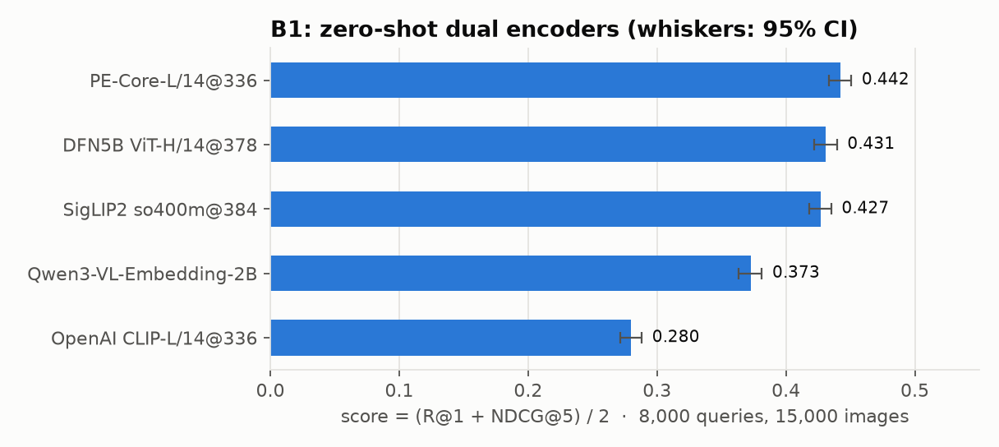
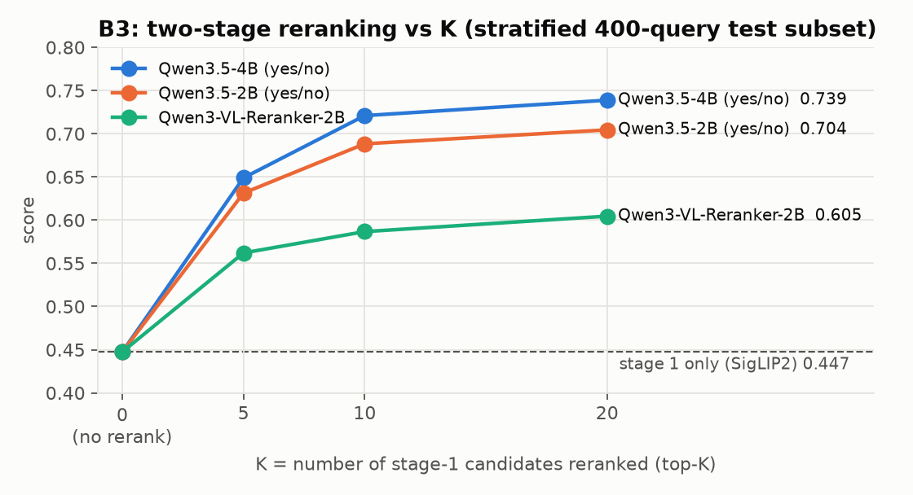

# HAIKUTHON 베이스라인 실험 리포트 (이찬)

> 11/11(수) 운영진 회의용입니다. 참가자 입장에서 문제를 직접 풀어 보고, 미결 사항 5개에 대한 근거를 측정했습니다.
> - 모든 수치는 `results/`의 실측값입니다. 추정치는 **(추정)**이라고 표시했습니다.
> - 측정 장비는 Mac Studio M4 Max(MPS, 통합 메모리 36GB)입니다. **시간 수치는 모두 MPS 기준이라 CUDA 규정값으로 바로 쓸 수 없습니다.**
> - 실험 계획은 [PLAN.md](PLAN.md), 결과 형식은 [RESULTS_SCHEMA.md](../RESULTS_SCHEMA.md), 전체 수치표는 [results/leaderboard.csv](results/leaderboard.csv)에 있습니다.

## 5줄 요약

1. **2단계 설계가 확실히 보상받습니다.** 1단계 dual encoder만 쓰면 0.43~0.44입니다. 소형 VLM(4B)으로 top-20을 재정렬하면 **0.74**까지 오릅니다(+0.29). 1단계 top-20에 정답이 98% 들어 있어서, 재정렬로 올릴 여지가 큽니다.
2. **시간 제한은 "2~4B VLM으로 top-5~10을 재정렬할 수 있는 정도"가 적절해 보입니다.** 다만 MPS 기준으로 test 전체 재정렬은 2시간 이상 걸립니다. **분 단위 수치는 대상 GPU에서 실측해 정해야 합니다**(5.1절의 산식과 절차 참고).
3. **어려움의 대부분은 HN이 아니라 stage1의 8문항 묶음 구조에서 나옵니다.** HN 7,000장은 점수를 0.09 낮춥니다. 그 결과 Public(0.47)과 Private(0.42)의 차이가 작습니다. **Public 1,000문항은 "쉬운 문항"이 아닙니다.**
4. **규정 허점:** 문항 간 1:1 할당(Hungarian 등)은 **+0.08~0.10점**을 줍니다. 프롬프트 텍스트만으로도 재현할 수 있으므로, **채점 서버가 구조적으로 막아야** 합니다. HN을 이미지 아티팩트로 구분하는 지름길은 없습니다(AUC 0.55).
5. **배포 패키지에 정답 누수가 있습니다.** `test_v1`의 파일명이 곧 정답이고, HN의 id 범위와 순서도 노출되어 있습니다. **배포 전에 익명화가 반드시 필요합니다.**

---

## 1. 회의 질문별 권고

| # | 질문 | 권고 | 핵심 근거 | 불확실성 |
|---|---|---|---|---|
| 1 | 추론 시간 제한 | 대상 GPU에서 "1단계 + 2~4B VLM, K=5~10"이 들어가고 "8B 이상, K=20"은 안 들어가는 값 | K에 따른 점수 곡선(§3.3), 쌍당 시간 실측 | CUDA 실측 없음. 9B 이상 미측정 |
| 2 | 모델 크기·용량 제한 | **추가 제한은 아직 불필요.** 시간 제한과 24GB 제한이 실질적인 제약 | 2B→4B: +0.035점, 시간 2배, 피크 11.9GB | 9B급 상한 미측정 |
| 3 | train HN 500장 제공 | B2 결과 반영 예정(§3.4). L2 결과로는 제공해도 지름길 위험이 낮음 | HN 탐지 AUC 0.55 | B2 진행 중 |
| 4 | 난이도(test HN 7,000) | **유지 가능.** 재정렬 상한이 약 0.74라 변별력이 남음. 더 어렵게 하려면 HN 수보다 묶음 구조가 지렛대 | HN 수 곡선(§3.5), 오답 분해 | 400문항 부분집합 CI ±0.04 |
| 5 | 규정 허점 | ① 채점 서버가 문항을 나눠 투입 ② 배포본 익명화 ③ top-1 중복률 모니터링 | L1 +0.08~0.10, L0 누수 4건 | 탐지 지표는 상위권에서 약해짐 |

### 1.1 질문 1: 추론 시간 제한

- **2단계로 얻는 이득이 큽니다.** 같은 400문항에서 1단계만 쓰면 0.447이고, Qwen3.5-4B로 재정렬하면 K=5에서 0.649, K=10에서 0.721, K=20에서 0.739입니다.
  - K=10 이후에는 상승폭이 작아집니다(+0.018).
  - 그래서 **K=5~10을 돌릴 수 있는 시간**이면 2단계 설계의 이득을 대부분 얻습니다.
- **전수 비교는 불가능합니다.** 쌍당 0.3초(MPS, 4B)로 1.2억 쌍을 비교하면 약 1년입니다. 따라서 어떤 현실적인 시간 제한에서도 참가자는 1단계로 후보를 좁혀야 합니다.
- **시간 산식** (재정렬 쌍마다 독립 채점)

  `총 시간 ≈ 모델 로딩 + 이미지 15,000장 인코딩 + 텍스트 8,000개 인코딩 + 8,000 × K × (쌍당 재정렬 시간)`

  | 구성 (MPS 실측 기반) | 1단계 | 쌍당 재정렬 시간 | K=5 | K=10 | K=20 |
  |---|---|---|---|---|---|
  | SigLIP2 + Qwen3.5-2B | 15분 | 0.156s | 약 2.0시간 | 3.7시간 | 7.2시간 |
  | SigLIP2 + Qwen3.5-4B | 15분 | 0.300s | 3.6시간 | 6.9시간 | 13.6시간 |
  | SigLIP2 + Qwen3-VL-Reranker-2B | 15분 | 0.153s | 2.0시간 | 3.7시간 | 7.1시간 |

  (재정렬 시간은 400문항에서 잰 쌍당 시간에 8,000 × K를 곱한 **추정**입니다.)
- **권고 절차**
  1. HAI 채점 서버와 같은 GPU에서 `scripts/predict.py`로 위 구성 2~3개의 쌍당 시간을 잽니다(각 10분이면 충분).
  2. "2B, K=10"은 들어가고 "4B, K=20"은 빠듯한 정도로 제한을 잡습니다.
- **참고 시나리오 (가정, 미검증):** 24GB CUDA GPU가 M4 Max MPS보다 3~6배 빠르다고 가정하면, "2B, K=10"은 약 40~75분, "2B, K=5"는 약 20~40분입니다. 이 가정이 맞으면 **30~60분** 범위가 후보입니다.
- Qwen3.5 계열의 MPS 시간은 실제보다 불리할 수 있습니다. linear-attention용 빠른 커널(flash-linear-attention)이 CUDA 전용이라, MPS에서는 느린 참조 구현으로 돌기 때문입니다.

### 1.2 질문 2: 모델 크기·용량 제한

- 2B → 4B: 같은 K에서 +0.02~0.035점, 쌍당 시간 2배, 피크 메모리 11.9GB(24GB의 절반)입니다.
- 모델별 메모리와 가중치 크기는 §3.8에 정리했습니다. 측정한 구성은 모두 12GB 이하이고, 1단계 모델은 3~8GB입니다.
- **24GB 제한이 이미 막는 것:** 같은 계열의 27B 모델(Qwen3.8-27B, 프롬프트를 생성한 모델)은 bf16으로 약 54GB라 4bit 없이는 들어가지 않습니다.
- 시간 제한이 빡빡하면 큰 재정렬기는 K를 줄여야 해서 이득이 상쇄됩니다. 그래서 **시간 제한이 실질적인 크기 제약 역할을 합니다.**
- **불확실성:** 9B급(Qwen3.5-9B, Qwen3-VL-Reranker-8B)은 디스크 사정으로 측정하지 못했습니다. 4B 이상에서 곡선이 얼마나 더 오르는지는 미확인입니다.

### 1.3 질문 3: train HN 500장 제공

- **L2 결과:** train HN으로 "이 이미지가 HN인가" 분류기를 학습하면 test AUC가 **0.547**입니다. 이를 점수 prior로 쓰면 오히려 점수가 내려갑니다(0.427 → 0.424). 생성 아티팩트로 HN을 걸러내는 지름길은 없습니다.
- 파일 크기, 밝기, 색감 같은 단순 통계로도 HN을 구분할 수 없습니다(AUC 0.50~0.54, L0).
- 학습 데이터로서의 효과는 B2 결과(§3.4)로 판단합니다. **⏳ B2 진행 중, 11/10 01:00 완료 예정**

### 1.4 질문 4: 난이도

- 오답 top-1의 출처(SigLIP2 zero-shot): **같은 묶음의 다른 원본 44.8%**, 그 원본의 HN 13.6%, **자기 HN 7.1%**, 기타 3.1%.
- 재정렬 후(Qwen3.5-4B, K=20)에도 남는 오답은 묶음 형제가 20.7%, 자기 HN이 4.3%입니다.
- **기준 문항 0.820 / 묶음 문항 0.383**(zero-shot). 난이도의 주된 원천은 묶음입니다.
- HN 수 곡선(zero-shot): 0장 0.516 → 3,500장 0.469 → 7,000장 0.427. 거의 선형으로 내려갑니다(§3.5).
- **Public이 쉽지 않습니다.** Public(HN이 없는 1,000문항, test `7000–7999`) 가운데 기준 문항은 98개뿐이고 902개가 묶음 문항입니다. 그래서 Public과 Private의 차이가 0.045에 그칩니다(Qwen3.5-4B 재정렬 후에는 0.733 대 0.741로 거의 0).
  - "Public = 쉬운 1,000문항"을 의도했다면, Public을 기준 문항 위주로 다시 뽑아야 합니다.

### 1.5 질문 5: 규정 허점

| 허점 | 이득 | 대응 |
|---|---|---|
| 전역 1:1 할당(Hungarian, top-50) | **+0.096** (0.427 → 0.523) | 채점 서버가 문항을 한 개씩, 또는 서로 다른 묶음이 섞인 작은 배치로 투입 |
| 프롬프트 텍스트로 묶음 복원 후 묶음 안 할당 | **+0.084** | 같음. 정규식만으로 묶음 900개 중 787개를 복원함 |
| greedy 1:1 할당 | +0.019 | 같음 |
| HN 탐지 prior | 이득 없음(AUC 0.55) | 불필요 |
| **데이터 패키지 누수**(§4) | 만점 가능 | 배포 전 익명화 |

- **탐지 지표:** 다른 문항과 top-1 이미지가 겹치는 문항의 비율입니다.
  - honest SigLIP2: 74.8%
  - 전역 Hungarian / greedy: 0%
  - 텍스트 묶음 할당: 10.7%
  - 단, 정직한 모델도 정확도가 오르면 겹침이 자연히 줄어듭니다. 그래서 상위권 제출에서는 보조 지표로만 쓸 수 있습니다.

---

## 2. 실험 조건

| 항목 | 내용 |
|---|---|
| 평가 집합 | test 프롬프트 8,000개(`outputs_stage2/test_prompts_v2.jsonl`), 후보 이미지 15,000장(원본 8,000 + HN 7,000, `test_v1`) |
| Public / Private | Public = HN이 없는 1,000문항(test `7000–7999`), Private = 7,000문항. HN 파일 순서와 이미지 유사도로 복원했습니다(§4). 공식 목록과 다르면 다시 계산해야 합니다. |
| 지표 | `score = (R@1 + NDCG@5)/2`, 문항 평균. 동점은 비관적으로 처리(정답과 점수가 같은 오답을 위로). 95% CI는 문항 bootstrap 1,000회 |
| B3 평가 | 비용 때문에 **Private 300 + Public 100 = 400문항 층화 부분집합**(seed 0)에서만 쟀습니다. 이 부분집합에서 1단계 점수는 0.447입니다(전체 0.427). |
| 장비 | Mac Studio M4 Max, MPS, fp16/bf16. 다른 작업과 공유하는 머신이라 일부 시간 측정에 잡음이 있을 수 있습니다. |
| 재현 | §6 |

## 3. 결과

### 3.1 B0: 랜덤 랭킹 (지표 검증)

평균 순위가 7,429로 기댓값 7,500.5와 맞고, KS 검정에서 균일분포가 기각되지 않습니다(p = 0.41). 지표 구현은 정상입니다.

### 3.2 B1: zero-shot dual encoder (test 전체)



| 모델 | score [95% CI] | R@1 | Public | Private | 기준 / 묶음 | R@5 / R@10 / R@20 | 시간(MPS) | 피크 | 파라미터 |
|---|---|---|---|---|---|---|---|---|---|
| PE-Core-L/14@336 | **0.442** [0.434, 0.451] | 0.328 | 0.480 | 0.436 | 0.799 / 0.402 | 0.761 / 0.904 / 0.969 | 12.1분 | 4.1GB | 0.67B |
| DFN5B ViT-H/14@378 | 0.431 [0.422, 0.440] | 0.318 | 0.475 | 0.424 | 0.809 / 0.389 | 0.746 / 0.913 / **0.988** | 28.2분 | 6.0GB | 0.99B |
| SigLIP2 so400m/16@384 | 0.427 [0.418, 0.435] | 0.315 | 0.466 | 0.421 | 0.820 / 0.383 | 0.741 / 0.908 / 0.984 | 15.0분 | 6.2GB | 1.14B |
| Qwen3-VL-Embedding-2B | 0.373 [0.363, 0.381] | 0.272 | 0.421 | 0.366 | 0.762 / 0.329 | 0.658 / 0.843 / 0.945 | 106.8분 | 8.3GB | 2.13B |
| OpenAI CLIP-L/14@336 | 0.280 [0.272, 0.288] | 0.193 | 0.311 | 0.276 | 0.634 / 0.241 | 0.533 / 0.729 / 0.868 | 10.3분 | 3.0GB | 0.43B |

- 최신 dual encoder 3종은 0.43~0.44로 비슷합니다. **VLM 기반 임베딩(Qwen3-VL-Embedding-2B)은 더 느리고(7배) 점수도 낮습니다.**
- 1단계에서 중요한 것은 R@1보다 **Recall@K**입니다. DFN5B와 SigLIP2는 top-20 안에 정답을 98% 이상 넣습니다.
- 시간은 대부분 이미지 인코딩입니다(SigLIP2: 15,000장에 790초, 초당 19장). I/O 대기는 0.1초뿐입니다.
- 텍스트 길이: SigLIP2의 64토큰 제한을 넘는 프롬프트는 0.8%뿐이라 영향은 무시할 만합니다.

### 3.3 B3: 2단계 재정렬 (400문항 부분집합)



| 재정렬기 (1단계 SigLIP2) | K=5 | K=10 | K=20 [95% CI] | Public / Private (K=20) | 쌍당 시간(MPS) | 피크 | 방식 |
|---|---|---|---|---|---|---|---|
| **Qwen3.5-4B** | 0.649 | 0.721 | **0.739** [0.702, 0.775] | 0.733 / 0.741 | 0.300s | 11.9GB | Yes/No 로짓 차(VQAScore 방식) |
| Qwen3.5-2B | 0.631 | 0.688 | 0.704 [0.666, 0.741] | 0.729 / 0.696 | 0.156s | 6.2GB | 같음 |
| Qwen3-VL-Reranker-2B | 0.562 | 0.587 | 0.605 [0.562, 0.645] | 0.665 / 0.584 | 0.153s | 6.2GB | 전용 멀티모달 cross-encoder |
| (1단계만) | — | — | 0.447 | — | — | — | — |

- 이 부분집합에서 1단계 Recall@5 / @10 / @20은 0.750 / 0.890 / 0.968입니다. 재정렬의 상한이 그만큼 열려 있습니다.
- 재정렬 후 정답 top-1 비율은 67.7%(4B, K=20)입니다. 남은 오답은 묶음 형제 20.7%, 자기 HN 4.3%, 형제의 HN 4.0%, 기타 3.3%입니다.
- 범용 VLM에 yes/no로 묻는 방식이 전용 재정렬 모델보다 약 0.1점 높습니다. 프롬프트는 "개수, 색, 재질, 무늬, 자세, 공간 관계를 모두 확인하라"는 내용입니다.
- 재정렬 점수는 쌍마다 독립이라, top-20을 한 번 채점해 K = 5, 10, 20의 결과를 모두 얻었습니다. 문항 간 정보는 쓰지 않았습니다.


### 3.4 B2: 파인튜닝 (진행 중)

**⏳ 11/10 01:00 완료 예정.** SigLIP2 so400m의 마지막 4블록과 head를 학습합니다. 조건은 sigmoid loss, 5 epoch, batch 32, train 3,500쌍(val 묶음 500문항 제외)입니다.

| 조건 | 내용 | score | Public | Private |
|---|---|---|---|---|
| (a) in-batch | 무작위 배치, in-batch negative만 | ⏳ | | |
| (a') 묶음 배치 | stage1 묶음 8개를 한 배치에 → hard in-batch negative | ⏳ | | |
| (b) 묶음 배치 + HN | 위 + train HN 398장을 추가 negative로 | ⏳ | | |

### 3.5 A1: HN 수에 따른 난이도 (SigLIP2 zero-shot, test 전체)


| 후보 풀 HN 수 | 0 | 1,000 | 1,750 | 3,500 | 5,250 | 7,000 |
|---|---|---|---|---|---|---|
| 전체 | 0.516 | 0.502 | 0.490 | 0.469 | 0.447 | 0.427 |
| 자기 HN이 풀에 있는 문항 | — | 0.466 | 0.451 | 0.439 | 0.433 | 0.421 |
| 자기 HN이 없는 문항 | 0.516 | 0.507 | 0.501 | 0.492 | 0.473 | 0.466 |

- 무작위로 HN을 골라 seed 3개 평균을 냈습니다.
- 자기 HN이 없는 문항도 점수가 내려갑니다(0.516 → 0.466). 다른 문항의 HN, 특히 묶음 형제의 HN이 혼동 후보로 작용하기 때문입니다.

### 3.6 L1: 문항 간 정보 활용 (규정 위반, 측정 전용)

규정상 **금지된 방법**입니다. 이 조항이 막는 이득을 재려는 목적이며, 채점 엔트리포인트(`scripts/predict.py`)는 이런 설정의 실행을 거부합니다.

| 방법 (SigLIP2 점수 위) | score | Public | Private | 상승폭 |
|---|---|---|---|---|
| 전역 1:1 최대 가중 매칭(top-50 희소 Hungarian) | 0.523 | 0.589 | 0.513 | +0.096 |
| stage1 정답 묶음 안 Hungarian(상한) | 0.512 | 0.573 | 0.503 | +0.085 |
| **텍스트로 복원한 묶음**(장소, 화풍, 시점) 안 Hungarian | 0.511 | 0.574 | 0.502 | +0.084 |
| greedy 1:1 할당 | 0.446 | 0.479 | 0.441 | +0.019 |

### 3.7 L2: HN 탐지기 (출제 의도 우회 시도)

- 방법: 동결 SigLIP2 임베딩에 로지스틱 회귀를 학습했습니다(train 원본 3,500장 vs HN 398장, val 묶음 제외).
- 결과: val AUC 0.550, **test AUC 0.547**입니다.
- 점수 prior로 쓰면: val에서 고른 λ = 0.01일 때 0.424, λ = 0일 때 0.427입니다. λ를 키울수록 점수가 내려갑니다.

### 3.8 모델별 메모리 사용량

**측정 방법**: MPS(통합 메모리)에서 `torch.mps.driver_allocated_memory()`를 배치마다 샘플링한 최댓값입니다.
- PyTorch 할당자 캐시까지 포함하므로 실제 텐서 메모리보다 다소 크게 잡히는 **상한값**이고, 배치 사이의 짧은 스파이크는 놓칠 수 있습니다.
- CUDA의 `torch.cuda.max_memory_allocated`와 수치가 똑같지는 않으므로, 24GB 규정 판단에는 **여유분을 두고** 참고해 주세요.
- 가중치 크기는 HF 허브에서 받은 파일 그대로의 크기입니다(배포 dtype 기준, 제출물 용량의 참고치).

| 역할 | 모델 | 파라미터 | 가중치 파일(배포 dtype) | 피크 메모리 | 측정 조건 |
|---|---|---|---|---|---|
| 1단계 | OpenAI CLIP-L/14@336 | 0.43B | 1.71GB (fp32) | **3.0GB** | 추론, 이미지 배치 32, fp16 |
| 1단계 | PE-Core-L/14@336 | 0.67B | 2.68GB (fp32) | **4.1GB** | 같음 |
| 1단계 | DFN5B ViT-H/14@378 | 0.99B | 3.95GB (fp32) | **6.0GB** | 같음 |
| 1단계 | SigLIP2 so400m/16@384 | 1.14B | 4.58GB (fp32) | **6.2GB** | 같음 |
| 1단계 | Qwen3-VL-Embedding-2B | 2.13B | 4.27GB (bf16) | **8.3GB** | 추론, 배치 16, bf16, 이미지 최대 768×768 |
| 2단계 | Qwen3-VL-Reranker-2B | 약 2.1B | 4.27GB (bf16) | **5.6GB** | 추론, 후보 10쌍씩, bf16, 이미지 최대 448×448 |
| 2단계 | Qwen3.5-2B (yes/no) | 약 2.2B | 4.57GB (bf16) | **5.6GB** | 같음 |
| 2단계 | Qwen3.5-4B (yes/no) | 약 4.5B | 9.34GB (bf16) | **11.9GB** | 같음 |
| 학습(B2) | SigLIP2 so400m (마지막 4블록 + head, 1.4억 파라미터 학습) | 1.14B | 체크포인트 0.56GB(학습한 텐서만) | (a) 약 21GB† / (b)(c) ⏳ | 학습, 배치 32, bf16 autocast, AdamW |

† 조건 (a)는 이 측정 기능을 추가하기 전에 시작했습니다. 학습 중 관측한 시스템 전체 GPU 할당량이라 다른 프로세스의 몫이 섞여 있을 수 있는 참고값입니다.

- **2단계 구성의 피크는 두 단계 중 큰 쪽입니다.** 파이프라인(`src/haiku_bl/pipeline.py`)은 재정렬기를 올리기 전에 1단계 모델을 해제합니다. 그래서 "SigLIP2 + Qwen3.5-4B" 구성의 피크는 약 12GB이고, 24GB의 절반 수준입니다.
- **24GB 안에서의 여유:** 측정한 최대 구성(4B 재정렬)도 절반만 씁니다. bf16 기준 9B급 재정렬기(가중치 약 18GB)는 들어갈 것으로 보이지만 **미측정(추정)**이고, 27B급(약 54GB)은 4bit 양자화 없이는 들어가지 않습니다.
- **함정 하나:** 파인튜닝할 때 입력 쪽 패치 임베딩까지 풀면, 학습하지 않는 블록의 활성값까지 모두 저장해 메모리가 약 30GB로 늘었습니다. 마지막 블록만 학습하려는 참가자도 같은 실수를 하기 쉽습니다. 24GB 제한이 있으면 이런 설정은 OOM으로 바로 드러납니다.

## 4. 데이터·출제 관련 발견 (배포 전에 조치 필요)

`results/l0_leak_audit/` 참고.

| # | 발견 | 영향 | 권고 |
|---|---|---|---|
| 1 | **원본 이미지 파일 id = 프롬프트 id** (`00000.png` = 프롬프트 `0000`의 정답, train/test 모두 100%) | id만 맞추면 만점 | 무작위 id로 바꾸고 순서 셔플 |
| 2 | HN이 별도 id 범위·폴더에 있음(`08000-14999`, train `4000-4499`) | id만으로 HN 제외 가능 | 원본과 HN을 한 폴더에 섞기 |
| 3 | `prompts.jsonl`에 HN 행이 `"hard_negative"`로 표시됨 | 위와 같음 | 참가자용 prompts에서 HN 행 제거 |
| 4 | HN 파일 순서 = 출처 원본 순서(HN `N+k`는 원본 `k`의 변형). 시드를 공유해 구도가 비슷하고, 픽셀만 비교해도 82%가 짝지어짐 | 원본-HN 쌍 노출 | 1~2번 조치로 해소 |
| 5 | **HN 출처 기록이 패키지에 없음**. 어느 1,000문항이 Public인지 공식 목록이 없음 | 평가 정의 불명확 | 공식 Public id 목록 확정. 본 리포트는 위 규칙(`7000–7999`)으로 복원 |
| 6 | Public 1,000문항 중 기준 문항이 98개뿐 | "Public = 쉬움" 의도와 다름 | 의도에 맞게 Public 재선정 검토 |
| 7 | stage3 설정상 train과 test 생성기가 같음(Qwen-Image-2512 + Lightning 8-step) | domain shift 없음(파일 크기·밝기 AUC 약 0.53) | 계획(FLUX/Z-Image)과 다르면 확인 필요 |
| 8 | v2 프롬프트는 critic 검수 기록이 없음(v1 기준 test 504건, train 155건 실패). 일부는 조명 표현이 stage1 컴포넌트와 다름 | 라벨 노이즈 가능성 | v2 검수 여부 확인 |

- 깨끗한 점: PNG 메타데이터 없음(`IHDR/IDAT/IEND`만 있음), 모두 768×768 RGB. 원본과 HN은 파일 크기와 색 통계로 구분되지 않습니다.

## 5. 한계와 남은 작업

- **CUDA 시간 측정이 없습니다.** 규정의 분 단위 수치는 대상 GPU에서 `predict.py`로 확정해야 합니다.
- **9B급 모델은 측정하지 못했습니다**(디스크 사정). 질문 2의 상한이 4B까지에 그칩니다.
- **B3는 400문항 부분집합 결과입니다.** 95% CI가 ±0.04 정도라, 0.03 안팎의 차이는 결론 근거로 쓰기 어렵습니다.
- **측정하지 않은 것:** 해상도(`max_pixels`) 비교, B4(검출기 기반 재정렬), 1단계 모델별 재정렬 조합.
- **머신 공유:** 측정 중 같은 머신에서 다른 작업이 돌았던 구간이 있어, 일부 시간 측정에 잡음이 있을 수 있습니다.

## 6. 재현

```bash
cd baselines/chan_lee
uv venv --python 3.12 .venv && VIRTUAL_ENV=.venv uv pip install -r requirements.txt
export HAIKU_DATA_ROOT=../../data   # data/train_v1, data/test_v1
.venv/bin/python scripts/pair_hn.py --split train && .venv/bin/python scripts/pair_hn.py --split test
.venv/bin/python scripts/check_leaks.py                                   # L0
.venv/bin/python scripts/run_exp.py --config configs/exp/b1_siglip2_so400m384.yaml   # B1 (L1도 같은 방식)
.venv/bin/python scripts/hn_ablation.py --config configs/exp/b1_siglip2_so400m384.yaml   # A1
.venv/bin/python scripts/l2_hn_detector.py --config configs/exp/b1_siglip2_so400m384.yaml # L2
.venv/bin/python scripts/run_rerank.py --config configs/exp/b3_siglip2__qwen35_4b.yaml   # B3
.venv/bin/python scripts/finetune.py --config configs/exp/b2_siglip2_bundle_hn.yaml      # B2
.venv/bin/python scripts/aggregate.py && .venv/bin/python scripts/make_figures.py
```

- 채점 서버 형식으로 시간을 재려면 `scripts/make_blind_test.py`(익명화 패키지 생성) → `scripts/predict.py --config ... --images ... --prompts ... --out sub.csv --timing-out timing.json` 순서로 실행합니다.
